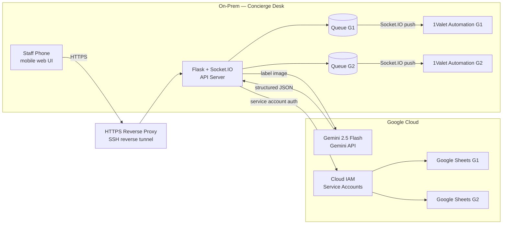
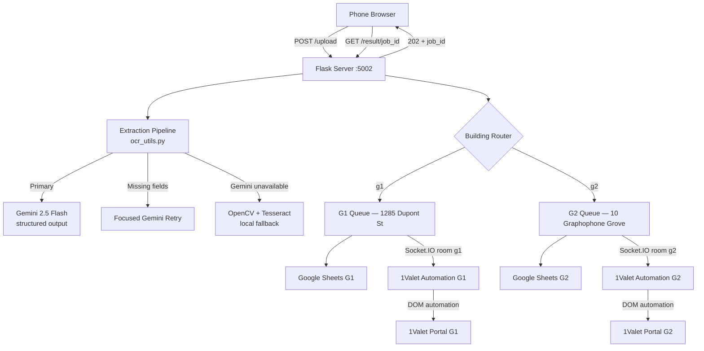
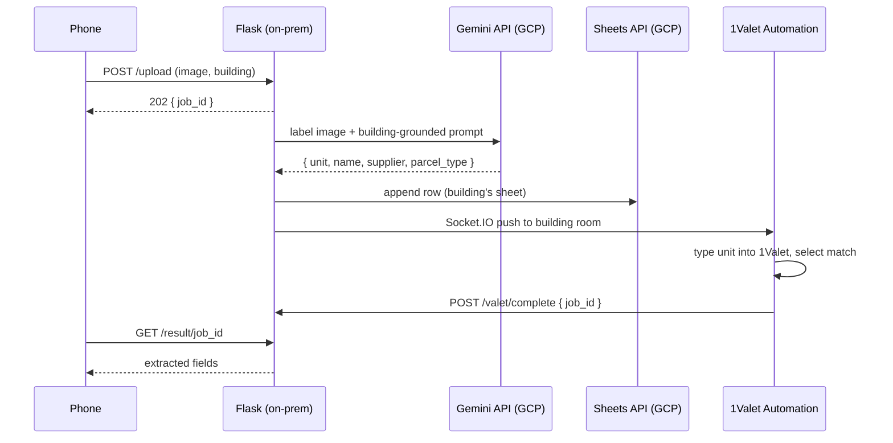
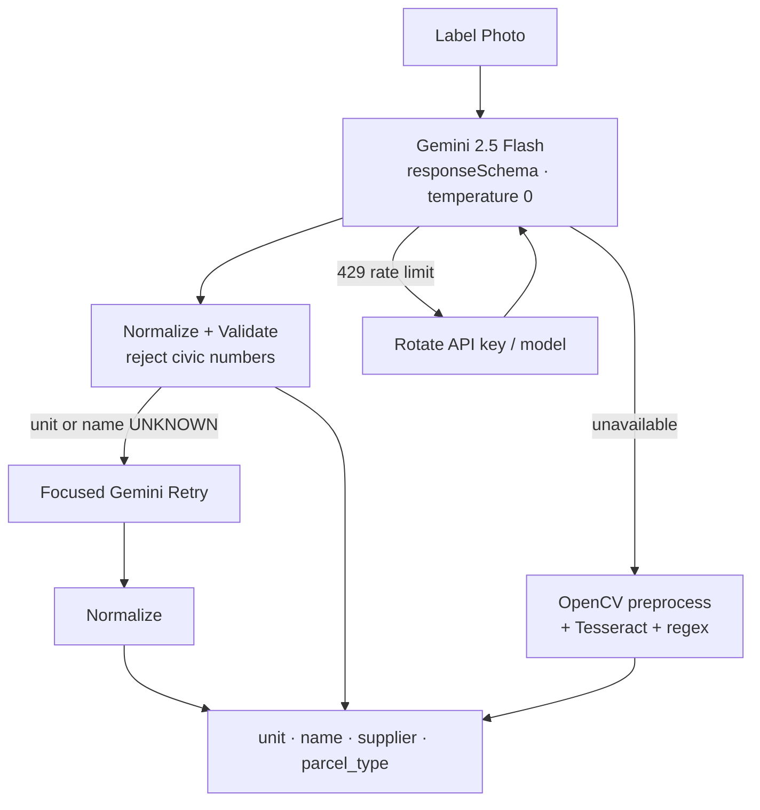

# ParcelVision — Gemini-Powered Parcel Intake (Hybrid On-Prem + Google Cloud)


> Snap a parcel label → Gemini reads the unit → it's logged to Google Sheets and entered into a smart-locker portal that has no API. Running in production at two downtown Toronto condos, adopted by the property manager as the standard intake workflow.

**55 s → under 8 s per parcel (85% faster) · ~96% unit accuracy on a 100-parcel sample · 100+ parcels/day · 2 buildings, 1 server**

> The original project README is preserved at [`backend/original.md`](./backend/original.md).

---

## Table of Contents

- [Demo](#demo)
- [The Problem](#the-problem)
- [Build · Secure · Scale](#build--secure--scale)
- [Hybrid Deployment Model](#hybrid-deployment-model)
- [Architecture](#architecture)
- [Gemini Extraction Pipeline](#gemini-extraction-pipeline)
- [Queue Architecture — Two Condos, One Server](#queue-architecture--two-condos-one-server)
- [1Valet Integration — Reverse-Engineered, No API](#1valet-integration--reverse-engineered-no-api)
- [Reliability](#reliability)
- [Tech Stack](#tech-stack)
- [Project Structure](#project-structure)
- [Setup](#setup)
- [Roadmap](#roadmap)

---

## Demo

### Label photo → structured data


### One-command startup — on-prem server + secure tunnel


### Full cycle — phone capture to locker-portal entry


### 1Valet browser automation listener


---

## The Problem

Condo concierge desks log every incoming parcel by hand: read the label, type it into a spreadsheet, then re-enter the same unit into the 1Valet smart-locker portal so the resident gets notified. At 100+ parcels a day that is ~55 seconds of repetitive typing per parcel — and a mistyped unit sends a parcel to the wrong door.

ParcelVision collapses that 5-step workflow into **one photo**.

---

## Build · Secure · Scale

### Build
A phone snap starts an AI-to-action pipeline. **Gemini 2.5 Flash**, a multimodal vision-language model, reads the label using schema-enforced structured outputs at temperature 0. Context-grounded prompting tells the model each building's address so it never mistakes the street number for the unit, and a self-correcting retry pass recovers missing fields. The result is written to the building's Google Sheet and streamed over Socket.IO to a browser automation script, which drives the 1Valet portal (no public API) through its reverse-engineered web interface. Handling time fell from 55 s to under 8 s per parcel (85% faster), with ~96% extraction accuracy on a 100-parcel sample.

### Secure
The data is residents' names and unit numbers, so the API is built to protect it:
- Constant-time HMAC token auth on every REST and WebSocket endpoint
- Per-IP rate limiting, 10 MB upload cap, and file-type validation
- LLM output treated as untrusted input before it touches the filesystem
- A separate **Google Cloud service account** per building, scoped to that building's sheet
- When Gemini isn't confident it returns `UNKNOWN`, and the parcel goes to staff instead of the wrong door

### Scale
One server runs both buildings with separate queues, sheets, credentials, and prompt context. Uploads return `HTTP 202` job IDs, and portal entries use idempotent job-ID acknowledgements so retries never drop or duplicate a parcel. Gemini calls rotate across API keys and fail over between 2 models on rate limits, with local OCR as a last resort. Next: config-driven onboarding so new buildings need zero code changes, with a migration path to **Cloud Run**.

---

## Hybrid Deployment Model

ParcelVision runs as a **hybrid deployment**: the application server lives **on-prem** at the concierge desk, next to the people and the locker portal it serves, while **AI inference, identity, and the system of record run on Google Cloud**.

| Tier | Where | What runs there | Why |
|---|---|---|---|
| **Edge / on-prem** | Concierge desk workstation | Flask + Flask-SocketIO API server, per-building work queues, 1Valet browser automation | The 1Valet portal session must live in the desk's browser; zero hosting cost; low latency to staff phones |
| **Google Cloud** | Gemini API | Gemini 2.5 Flash multimodal label extraction (structured JSON output) | Managed, scalable vision-language inference — no GPUs to run on-prem |
| **Google Cloud** | Cloud IAM service accounts | One service account per building, scoped to that building's sheet | Least-privilege, per-tenant credentials |
| **Google Cloud** | Google Sheets API (Workspace) | Per-building parcel log — the staff-facing system of record | Staff keep the tool they already use |
| **Ingress** | SSH reverse tunnel + hosted HTTPS reverse proxy | Public HTTPS URL → on-prem server, no open inbound ports | Works behind building NAT/firewall with no DNS setup |



---

## Architecture





---

## Gemini Extraction Pipeline



- **Structured output** — Gemini is called with a JSON `responseSchema`, `temperature 0`, and `responseMimeType: application/json`, so every response parses into the same record shape.
- **Context-grounded prompting** — each request tells Gemini which building the parcel was scanned at, including its street (civic) number. The model is told the unit is always the *other* number on the address line, and the server rejects any answer equal to a civic number.
- **Conservative by design** — when the unit isn't clearly readable, Gemini returns `UNKNOWN` and the parcel is flagged for staff instead of guessed. A wrong guess means the wrong door.
- **Focused retry** — if the first pass leaves the unit or name `UNKNOWN`, a second, narrower Gemini call targets only the recipient block.
- **Local fallback** — if Gemini is unreachable, OpenCV preprocessing (denoise, CLAHE, sharpen) + Tesseract + regex extraction keeps intake running.

**Parcel type classification**

| Type | Detected as |
|---|---|
| Amazon blue poly mailer | `PRIME BLUE PACKAGE` |
| Amazon orange packaging | `PRIME ORANGE PACKAGE` |
| Amazon cardboard box | `AMAZON BOX` |
| Brown cardboard box | `BROWN BOX` |
| White / black / blue / pink / grey soft bag | `<COLOR> PACKAGE` |
| White / black / blue / pink rigid box | `<COLOR> BOX` |
| Transparent poly bag | `CLEAR PACKAGE` |

---

## Queue Architecture — Two Condos, One Server

Both buildings share one server but are isolated at every layer that matters:

| Concern | Isolation |
|---|---|
| Work queue | `pending_units_queue["g1"]` / `["g2"]` |
| Real-time delivery | Socket.IO room per building |
| System of record | Separate Google Sheet per building |
| Credentials | Separate Google Cloud service account per building |
| Prompt context | Building name + civic number injected per request |
| Portal session | Separate 1Valet browser tab + automation script per building |

**How a parcel flows:**

1. **Async intake** — `/upload` returns `202 Accepted` with a `job_id` immediately; Gemini extraction runs on a background thread so the phone never waits on a slow request.
2. **Fan-out** — the result is written to the building's sheet and appended to that building's queue.
3. **Push, not poll** — the server emits to the building's Socket.IO room; the automation script picks the parcel up instantly. `/valet/pending` remains the source of truth for reconnects.
4. **Acknowledge by job ID** — after a successful portal entry the script calls `/valet/complete` with the `job_id`, removing exactly that parcel. Two parcels for the same unit are never collapsed, and a failed entry stays queued for retry.

---

## 1Valet Integration — Reverse-Engineered, No API

1Valet has no public API, SDK, or documentation. The integration was built by reverse-engineering its web portal:

1. **DOM inspection** — located the suite input by placeholder text and autocomplete options by text content and visible bounding box.
2. **Event simulation** — dispatched `input`, `change`, and `keydown` events in sequence so the portal's front-end state updates exactly as if a person typed.
3. **Autocomplete selection** — clicks the matching suite; falls back to `Enter` if no match renders.
4. **Re-focus loop** — re-focuses the input after each entry so the popup stays open for the next parcel.

The automation script is self-contained: paste `backend/smartlockerscript.txt` (G2) or `backend/smartlockerscript_g1.txt` (G1) into the 1Valet tab's console. `start.sh` stamps the current public URL into both on every run.

---

## Reliability

| Failure | Handling |
|---|---|
| Gemini rate limit (HTTP 429) | Rotate across multiple API keys × 2 Gemini models |
| Gemini unavailable | Local OpenCV + Tesseract fallback |
| Unreadable unit | `UNKNOWN` → staff alert instead of a guess |
| Slow extraction vs. proxy timeout | Async `202` + `job_id` polling |
| Portal entry fails | Item stays queued; acknowledged only by `job_id` |
| Tunnel provider down | `start.sh` falls back serveo.net → localhost.run → LAN IP |
| Stale Sheets session | Cached client invalidated and retried |

---

## Tech Stack

| Layer | Technology |
|---|---|
| AI / vision | **Google Gemini 2.5 Flash** (Gemini API) · structured output · OpenCV · Tesseract |
| Cloud | **Google Cloud** — Gemini API · Cloud IAM service accounts · Google Sheets API |
| Backend (on-prem) | Python · Flask · Flask-SocketIO · threading |
| Real-time | Socket.IO rooms (WebSocket) |
| Data / system of record | Google Sheets · gspread |
| Browser automation | Vanilla JavaScript · DOM event simulation |
| Ingress | SSH reverse tunnel behind hosted HTTPS reverse proxy |
| Frontend | HTML · CSS · vanilla JS (mobile, camera-first) |
| Ops | Bash (`start.sh`) · Windows · Git Bash · Python venv |

---

## Project Structure

```
ParcelVision/
  README.md                     this file
  start.sh                      one-command startup: tunnel + Flask + URL stamp
  demo*.svg                     demo animations
  backend/
    original.md                 original project README
    app2.py                     Flask + Socket.IO server — /upload, /result, /valet/*
    ocr_utils.py                Gemini pipeline: structured output -> retry -> local fallback
    sheet_utils.py              Google Sheets writer — per-building service accounts
    vision_utils.py             thin wrapper around ocr_utils
    smartlockerscript.txt       1Valet automation (G2)
    smartlockerscript_g1.txt    1Valet automation (G1)
    templates/index.html        mobile upload UI
    requirements.txt
```

---

## Setup

**1. Clone and install**

```bash
git clone https://github.com/nruppatel16/ParcelVision.git
cd ParcelVision/backend
python -m venv venv
source venv/Scripts/activate   # Windows Git Bash
pip install -r requirements.txt
```

**2. Google Cloud**

- Create a Gemini API key in Google AI Studio (comma-separate several keys to enable rotation).
- Create one service account per building in your Google Cloud project, download its key, and share that building's Google Sheet with the service account email.

**3. Create `backend/.env`**

```env
GEMINI_API_KEY=key_one,key_two

# Building G2
SHEET_ID=your_g2_sheet_id
WORKSHEET_NAME=PACKAGES NEW

# Building G1
G1_SHEET_ID=your_g1_sheet_id
G1_WORKSHEET_NAME=PACKAGES NEW
G1_CREDENTIALS_PATH=credentials_g1.json
```

Place `credentials.json` (G2) and `credentials_g1.json` (G1) in `backend/`. Neither is committed.

**4. Start the on-prem server**

```bash
./start.sh
```

Opens the tunnel, stamps the public URL into both automation scripts, and starts Flask on port 5002. The terminal prints the URL for staff phones.

**5. Start the 1Valet automation**

Open the 1Valet "Add Delivery" popup, paste the building's automation script into the browser console; the listener starts in 3 seconds.

---

## Roadmap

Planned next steps for the Google Cloud side of the hybrid model (not yet built):

- **Cloud Run** for the API tier, with the on-prem desk keeping only the 1Valet automation as an edge agent
- **Cloud Storage** for label images and **Cloud SQL (PostgreSQL)** for queues and parcel history
- **Secret Manager** for API keys and service-account credentials
- **Terraform** for reproducible infrastructure
- **Config-as-data onboarding** so adding a building needs zero code changes
